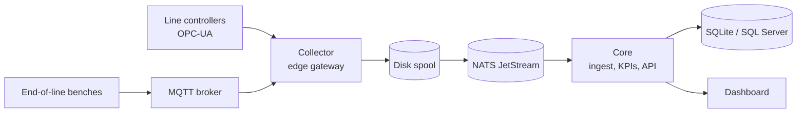

# LinePulse

A small telemetry pipeline for an automotive pump plant, built to answer the questions a
production-software team is asked every day, and to stay correct when the plant network does
what plant networks do.

It reads machine state from line controllers over OPC-UA and per-part test records from
end-of-line benches over MQTT, keeps every event exactly once, and turns them into numbers a
production engineer can argue with. Everything is simulated; see [what is simulated](#what-is-simulated-and-what-is-real).

## The problems it addresses

| The question | Where it shows | Decision it supports |
|---|---|---|
| **Where did this line's availability go?** Stops under two minutes never reach a shift report. | Dashboard: *Where did the time go?* | Which small, repeated stops are worth a maintenance hour. |
| **For part serial X, what were its test values, which housing lot, and which machining tool made that lot?** The question a warranty claim asks, years later. | Dashboard: *Part genealogy*, `GET /api/parts/{serial}` | Scoping a warranty claim to a lot instead of a model year. |
| **Is a leak-test fixture drifting while every part still passes?** | Dashboard: *Leak-test fixtures* | Replacing a seal before it makes scrap. |
| **How do Izmir and Nis compare on the same product?** | Dashboard: *Izmir and Nis, same shift* | Knowing where to send help. |
| **Does it stay correct with duplicate messages, out-of-order events and connectivity loss?** | [Verification](#verification), `tools/verify.py` | Trusting the numbers above. |

The last row is the one the numbers cannot answer by being plausible, so the project proves it
with measurements against ground truth the simulators write down themselves.

## Architecture



Full design, with the reasoning and the failure modes: [docs/ARCHITECTURE.md](docs/ARCHITECTURE.md).
The plant being modelled: [docs/DOMAIN.md](docs/DOMAIN.md). Choices and their reasons:
[docs/DECISIONS.md](docs/DECISIONS.md). Kepware: [docs/KEPWARE.md](docs/KEPWARE.md).
A ten-minute live walkthrough: [docs/DEMO.md](docs/DEMO.md).

## Live demo

**https://linepulse.hanwas.digital** runs the whole lab, simulators included, on one small Fly.io
machine. Everything on the page is simulated.

- **It sleeps.** The machine is stopped when nobody is looking and started by the first request, so an
  idle demo costs almost nothing. Measured once: it stopped about nine and a half minutes after the last
  request; the first request after that returned in 6.3 s, the page itself 0.4 s later, and the first
  hundred and fifty events were in the database 16 s after the request. A tab left open keeps it awake.
- **It forgets.** Every start is a clean lab: the data directory is wiped, and the machine also restarts
  itself every twelve hours. A stopped machine's silence would otherwise be read as a line standing
  still for an hour, which is wrong.
- **What is exposed.** Only the dashboard and its read-only API. NATS, the MQTT broker and the OPC-UA
  server listen inside the machine and are not published. The API has no authentication, and there is
  nothing in it that is not simulated.
- **What is logged.** Each page load writes one line to the platform log: time, client IP, the edge
  region that accepted the connection, the path, the referring site's host and the browser's user
  agent. API calls and health checks are not logged. The platform keeps the log searchable for about
  seven days; nothing is stored in the lab's database.
- **What is not shown.** The verification scenarios, the documentation and the source are not part of
  the deployed image.

Deployment files: `fly.toml`, `deploy/Dockerfile`, `deploy/start.sh` (a small supervisor that starts the
components in order and ends the machine if any of them dies, so the platform restarts it clean). The
image is built by Fly's remote builder; Docker is not needed locally.

```bash
fly apps create <name>        # once; set `app` in fly.toml to match
fly deploy --remote-only --ha=false
```

## Quick start

Needs .NET 8 SDK, Python 3.11+, Node is **not** needed, and `nats-server` (`brew install nats-server`).

```bash
python3 -m venv .venv && .venv/bin/pip install -r requirements.txt   # once
caffeinate -i scripts/run-all.sh        # builds, starts everything in order, about a minute
open http://localhost:5080              # the dashboard
.venv/bin/python3 tools/verify.py       # the verification suite, about seven minutes
scripts/stop-all.sh
```

`caffeinate -i` keeps a laptop awake. A machine that sleeps in the middle of a run produces
numbers that are wrong in ways that look right.

## Verification

`tools/verify.py` runs the real pipeline under fault injection and compares the result with
what the simulators actually sent. Each scenario prints a PASS/FAIL table of observed numbers
and the script exits non-zero if anything fails.

| Scenario | What it does | What must hold |
|---|---|---|
| `chaos` | 10% of bench records republished (half with a new `eventId`), 5% held back and released out of order, and the event bus stopped for 20 s | Every distinct part stored exactly once; every injected duplicate accounted for; nothing lost across the outage; spool empty at the end |
| `order` | Machine samples fed straight to the core in order to one line and shuffled to another, with a late event inside the watermark, one beyond it, and duplicates; a third line has its PLC counter reset | The two lines' minute buckets are identical and equal what the samples add up to; no negative production |
| `consumer` | The core service stopped for 15 s while data flows | Every event the collector handed over is stored |
| `collector` | The collector killed with `SIGKILL` | Nothing stored twice; spool empty; nothing lost |
| `broker` | The MQTT broker stopped for 15 s | Nothing stored twice; the collector resubscribes by itself; records resume |
| `plc` | The OPC-UA server power-cycled, counters back to zero | Collector reconnects on its own; no negative production |

Smaller checks: `dotnet test` (66 unit tests: shift calendar across time zones and daylight saving,
minute arithmetic, OEE conventions, SPC, watermark, deduplication, decoding), `sim/test_bench.py`
(the simulated data itself), `tools/api_smoke.py` (every API route against full, empty and past
windows, and the shift calendar against an independent calculation), and `tools/dashboard_check.mjs`
(runs the dashboard's own script against the live API and checks every panel renders; it does not
check appearance).

<!-- MEASURED:start -->
## Measured results

One run of the final code, on an Intel Mac (macOS 12.7.6, 4 cores, 8 GB) running everything at
once, simulators at 20x. `tools/verify.py` ran all six scenarios in about 8 minutes:
**44 of 44 checks passed**. The simulators are random, so counts differ from run to run by a few
percent; what is asserted is equality between what was sent and what was stored, not the counts.

**`chaos`: duplicates, late records and a 20-second outage of the event bus**

| | Result |
|---|---|
| Distinct parts the benches minted, and stored | 841 and 841, each exactly once |
| Messages the benches published, and received by the collector | 933 and 933 |
| Duplicates injected, and rejected at the edge | 92 and 92 (47 of them carried a fresh `eventId`) |
| Redeliveries by the stream, rejected by the core | 0 in this run (one was seen in an earlier run, when an acknowledgement was lost while the bus restarted; the primary key made it harmless) |
| Late records released out of order | 31 |
| Events lost across the outage | 0 (spool peaked at 340 events; the spool was empty again 2.1 s after it came back) |
| Throughput | 15.9 events/s over 120s; 473 events/s while the spool drained |
| Latency of machine samples, outside the outage and 15 s after it (p50 / p99) | 311 ms / 468 ms |
| Latency of test records, same window (p50 / p99) | 58 ms / 936 ms, including the 5% held back on purpose |
| Worst latency of an event produced during the outage | 29.7 s (the outage lasted 20 s) |

Run to run, the tail varies. Across the three runs of this code that were logged, the 99th-percentile
latency of test records was 1.0, 1.1 and 2.1 seconds (the hold-back alone accounts for up to 1.0 s), that of
machine samples 0.4 to 0.5 seconds, and the peak drain rate 320 to 500 events per second. The first two
values of each range were recorded by hand from earlier runs of the same code, not produced by this table.

**`consumer`: the core service stopped for 15 seconds while data flows**

| | Result |
|---|---|
| Events the collector handed over, and stored by the core | 917 and 917 (509 machine samples + 408 test records) |
| Lost between the stream and the database | 0 events (0.0% of the run) |
| The earlier design (plain publish/subscribe), same experiment | 201 of 861 events lost (23.3%) |

The last row is not from this run. It is the measurement that made the design change, recorded
in [docs/ARCHITECTURE.md](docs/ARCHITECTURE.md).

**`collector`, `broker`, `plc`, `order`**

| Scenario | Result |
|---|---|
| Collector killed with `SIGKILL` for 10 s | Test records minted / stored / missing: 313 / 313 / 0; spool empty |
| MQTT broker stopped for 15 s | Bench records minted / published / stored: 355 / 355 / 355; the collector resubscribed by itself |
| OPC-UA server power-cycled, counters back to zero | Collector reconnected on its own; no negative production; reset present on all 4 lines |
| Shuffled delivery against in-order delivery | Minute buckets identical; total good parts equal last counter minus first; one late event inside the watermark, one beyond it, three redeliveries rejected; a 60 s stop classed as a micro-stop and a 240 s stop not |

**Fixture drift** (a separate live run with the simulated seal wear sped up five times): the drifting
fixture went from `ok` to `warning` after about 100 seconds and 83 parts, and to `alarm` after about 120
seconds. All 109 of its tests passed and its highest reading was 45% of the limit. The other fixtures
stayed `ok`.

How to reproduce: `tools/verify.py` (or `--scenario chaos`, `consumer`, `collector`, `broker`, `plc`, `order`).
<!-- MEASURED:end -->

## What is simulated, and what is real

| Simulated | Real |
|---|---|
| The line controllers and their OPC-UA server (`sim/opcua_line_server.py`) | The OPC-UA client, subscriptions, reconnection and counter handling in the collector |
| The end-of-line benches (`sim/mqtt_bench.py`) | The MQTT client, the spool, forwarding, deduplication |
| Every measured value, cycle time, reason code and limit | Event-time bucketing, the watermark, minute rebuilds, downtime derivation |
| Time (`LP_SPEED`, default 20x) | The OEE, first-pass-yield and SPC arithmetic, and the HTTP API |

The plant details (about 400 people, 13 lines and a machining centre, oil and vacuum pumps, a
second site in Nis) came from a recruiter conversation. Everything else about the plant is a
modelling assumption, as [docs/DOMAIN.md](docs/DOMAIN.md) says.

## What this does not claim

- It is a laboratory. It has run at about fifteen events per second on one laptop. It is not a
  load test and says nothing about plant scale.
- **Kepware has not been used.** The OPC-UA simulator stands where a connectivity server would.
  [docs/KEPWARE.md](docs/KEPWARE.md) says what would change; none of it has been tried.
- The SQL Server schema (`db/mssql/schema.sql`) has **not been executed** and the SQL Server data
  provider is not written. The lab stores to SQLite behind the same interfaces.
- The dashboard is one plain HTML file, not an Angular application.
- The live demo has not been load tested and has no authentication; it is a showcase of simulated data, not a service.
- A late **state change** revises the OEE minute buckets but not the list of downtime events: the
  downtime state machine refuses to move backwards and counts the refusal.
- The OPC-UA endpoint, the MQTT broker and NATS have no authentication or encryption, and the
  collector auto-accepts untrusted server certificates. A plant needs all of that.
- Everything runs as a single process each. A full disk, a consumer outage longer than the
  stream's 24-hour retention, a bench process dying while holding unsent records, and badly
  skewed producer clocks are not tested.
- A controller does not buffer, so machine state changes while the collector is away are not
  observed. A subscription cannot see an event shorter than its sampling interval.

## Repository

```
sim/        the simulators and the test of their data
src/        Contracts (events), Collector (edge), Core (ingest, KPIs, API, dashboard), Broker
db/mssql/   the SQL Server schema (not executed)
scripts/    run-all.sh, stop-all.sh
tools/      verify.py, api_smoke.py, chaos.sh
docs/       architecture, domain, decisions, Kepware, demo
```
