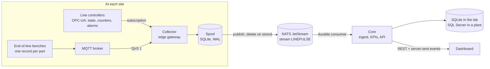

# Architecture

## The pipeline

In the lab everything runs on one machine and a single collector serves the lines of both
simulated sites. In a plant the collector is a small box per site and the core is central;
nothing in the code assumes otherwise.

| Component | Where | What it does |
|---|---|---|
| Line simulator | `sim/opcua_line_server.py` | Stands in for the controllers (or a connectivity server in front of them). |
| Bench simulator | `sim/mqtt_bench.py` | Stands in for the leak and flow benches. Injects duplicates, late records and bursts on request, and writes down what it really sent. |
| Collector | `src/LinePulse.Collector` | Reads both, writes every event to a local disk spool, forwards the spool to the stream. |
| Core | `src/LinePulse.Core` | Deduplicates, stores raw events, builds minute buckets by event time, derives downtime, computes KPIs, serves the API and the dashboard. |
| MQTT broker | `src/LinePulse.Broker` | A small in-process broker so the lab needs no external one. |

## Why two protocols

OPC-UA carries machine **state and counters**. MQTT carries **per-part test records**. Each
protocol carries what it is good at.

A controller exposes values that change. Subscribing to them is the natural model: the server
reports changes, the client does not poll, and the cost is one monitored item per tag. State
and counters fit exactly. A test bench is different: it is a PC that produces one discrete
record per part (serial, limits, measured values, verdict) and, in most plants, leaves it in
a file. A broker with acknowledged delivery is the natural way to move those.

Swapping them breaks both. Sending parts as OPC-UA value changes loses any record that arrives
between two samples, because a subscription reports the latest value, not every value. Sending
counters as messages invents a stream of events no controller emits, and moves the work of
detecting a restarted counter into every consumer.

## The reliability design

The job description asks for systems that "handle production realities: high data volumes,
concurrency, connectivity issues, duplicate messages, out-of-order events". Each of those has
a specific answer here, and a specific test in `tools/verify.py`.

### Nothing is forwarded from memory: store, then forward

Every event the collector receives is written to a SQLite spool (WAL mode) before anything
else happens to it. A forwarder drains the spool into NATS in batches, and an entry is
deleted only after the stream has acknowledged it as stored. If the uplink goes down, the
spool grows; when it returns, the spool drains. If the collector is killed, the spool is on
disk.

The deletion rule has a precise meaning, and getting it right was a measured correction (see
"The consumer outage" below). The acknowledgement is JetStream's: the message is persisted in
the stream. It is not "the server accepted it".

### Duplicates: three layers on one rule

The idempotency key is `(source, seq)`: the producer's own sequence number. It is deliberately
not `eventId`, because a bench that restarts mints a new `eventId` for a part it already
reported. The simulator makes this happen on purpose.

1. **Edge window.** The collector remembers the keys it has forwarded for six hours and drops a
   republished message before it is spooled.
2. **Stream window.** Each message carries `Nats-Msg-Id = source#seq`; the stream refuses a
   repeat inside its duplicate window (ten minutes). This also makes retrying a half-sent
   batch safe.
3. **Primary key.** The raw tables are keyed on `(source, seq)`, and checking and writing are
   one statement. This is the guarantee; the others are cheaper ways to avoid reaching it.

Why the edge window alone is not enough: it is a window. A duplicate that arrives after six
hours, or after the box was reimaged, gets through it. And two collectors would not see each
other's keys. The primary key does not forget and does not depend on how many processes there
are. Two cheap checks in different places, over one guarantee that cannot be bypassed.

A key seen again with a **different event time** is not a duplicate. It means the producer
lost its counter and is reusing numbers for new parts, so it is refused and counted
separately (`KeyConflict`): filing it as a duplicate would hide new parts behind old ones.

### Out-of-order events: event time, a watermark per stream, and rebuilding

Everything is bucketed on the time the event **happened** (`ts`, stamped by the producer), never
on when it arrived. A bench that reconnects after a blip delivers twenty minutes of records
at once; bucketed by arrival, the shift report would show a dead line followed by an
impossible minute.

The watermark belongs to a **stream**, not to the line or the plant: one line's PLC samples, or
one line's bench records. Producers stamp events with their own clocks, and the bench (a PC)
and the PLC data (through an OPC-UA server) are routinely seconds apart. A shared watermark
would let a fast clock seal minutes before the other producer's data had arrived. A stream is
only ever judged against itself.

A late event is classified against its stream's watermark (30 s):

- **inside the watermark**: an ordinary correction. Applied and counted.
- **beyond the watermark**: its minute was already settled. Applied, counted, and the bucket is
  marked as revised so somebody can see which number moved and how often. Never dropped.

A minute is **rebuilt from its raw rows**, never patched: `MinuteAggregator` is a pure function
of the samples in and before the minute. Rebuilding makes the repair exact however many late
events arrive in whatever order, and makes a bucket reproducible when someone challenges it.
The cost is that a rebuild reads every sample in the minute, so dirty minutes are coalesced
and rebuilt every 500 ms rather than once per event.

The order inside `IngestPipeline` matters: store, classify, mark dirty, advance the watermark.
A flush that runs between "mark dirty" and "advance" can only see a watermark that has not
yet passed the minutes about to be rebuilt, so it cannot seal a minute this event still has
to revise.

### PLC counters are monotonic, arbitrary, and sometimes restart

A counter starts wherever it starts, and goes back to zero when the controller is power-cycled
or the tag is reset. So production is derived from **deltas between consecutive samples**, the
first sample of a line only sets the baseline, and a delta that is negative is dropped and the
baseline re-anchored. The alternative, a line that un-builds pumps for one minute, is wrong in
a way nobody notices.

### What a restart does

The dirty-minute queue is in memory. A core process killed between storing an event and
flushing its minute keeps the event and loses the mark. On start the core re-queues the last
ten minutes of every line; rebuilding is idempotent, so this is cheap and closes the gap. The
stream's durable consumer resumes at the first event the core did not acknowledge.

## The consumer outage: a measured correction

The first version of this pipeline published to core NATS and treated a PING/PONG round trip
as confirmation, on the reasoning that the collector's spool already provides replay.
`tools/verify.py --scenario consumer` stops the core for 15 seconds while data flows:

| Transport | Events handed over by the collector | Stored by the core | Lost |
|---|---:|---:|---:|
| core NATS (publish/subscribe) | 861 | 660 | **201 (23.3%)** |
| JetStream, durable consumer | 847 | 847 | **0** |

The first row is the earlier design, measured. A PONG proves the server accepted the message;
core NATS keeps nothing for a subscriber that is not connected; and the collector deleted the
spool entry on the PONG. The spool did not cover the one case where the consumer, not the
link, was the problem. The fix was to move the memory of "how far has the reader got" into
the server: a persisted stream and a durable consumer. The consumer acknowledges an event only
after storing it, and is idempotent, so at-least-once delivery is safe.

## Failure modes

What was tested is marked with the scenario that tested it. "Untested" means exactly that.

| What breaks | What the system does | What an operator sees | Tested by |
|---|---|---|---|
| NATS server down | Collector keeps spooling to disk; forwards when it returns | Collector log: spool depth rising; dashboard values freeze, "last seen" ages | `chaos` |
| Duplicate messages (QoS 1 redelivery, bench restart) | Dropped at the edge, the stream, or the primary key; counted | `duplicatesRejected` on the collector, `deduped` on `/api/health` | `chaos`, `order` |
| Late or out-of-order events | Classified against the stream's watermark; minute rebuilt; beyond-watermark counted and the bucket marked revised | `lateApplied`, `lateBeyondWatermark`; `revisions` on the bucket | `order` |
| Core service down | Events wait in the stream; the durable consumer resumes where it stopped | Dashboard unreachable, then catches up | `consumer` |
| Collector killed (`kill -9`) | Spool is on disk and resumes; the broker holds bench records for the subscribed collector | Gap in machine state while it was away | `collector` |
| OPC-UA server restarted | Session re-established with bounded backoff; counters re-baselined | Brief stale state; no negative production | `plc` |
| PLC counter reset | Negative delta dropped, baseline re-anchored | Nothing | `order`, `plc` |
| Late *state change* | Minute buckets absorb it; the downtime event list does not move backwards | `outOfOrderState` counter | `order` |
| MQTT broker down | Benches queue at QoS 1 on a persistent session and deliver on reconnect; the collector resubscribes by itself | Bench records pause, then arrive together | `broker` (15 s outage, 374 records minted, 374 stored) |
| Bench process dies holding its unsent queue | That queue is in memory; those records are gone | A gap in one bench's serials | not tested |
| Disk full / SQLite locked | Untested | Untested | not tested |
| Consumer down longer than stream retention (24 h) | Events older than the retention fall off the stream | Missing history | not tested |
| Producer clock far off | Designed for (per-stream watermark); not tested | Untested | not tested |

Two things are physically unrecoverable and are not claimed: a controller does not buffer, so
machine state changes while the collector is away are simply not observed; and a subscription
cannot see an event shorter than its sampling interval (100 ms here), in a lab or on a line.

## What would change at real scale

None of this has been run at plant scale. The lab runs ~15 events per second. These are the
places where scale would change the design, and the first questions to ask.

- **Stream sizing and retention.** The stream is the buffer for a consumer outage; its
  retention is how long an outage can last. Size it from event rate times the longest outage
  the plant will tolerate, replicate it across nodes, and partition by site so one site's
  burst cannot starve another's consumer.
- **Hot state in Redis.** Current state per line is held in the core's memory and rebuilt from
  the database at start. With several core instances it would live in a shared cache.
- **SQL Server.** The data access is behind two interfaces, and `db/mssql/schema.sql` is
  written for SQL Server, but it has **not been executed** and the SQL Server provider is not
  written. Real work is sizing, index maintenance on the raw tables (the clustered key is
  line and event time, chosen for the minute rebuild), and partitioning by month for retention.
- **Minute-rebuild cost.** A rebuild reads every sample in the minute; at thousands of events
  per second per line the coalescing interval and the aggregation need measuring, not assuming.
- **Security.** The lab's OPC-UA endpoint is anonymous and unencrypted (the simulator logs
  "No signing policy available"), the MQTT broker and NATS have no authentication, and the
  collector auto-accepts untrusted server certificates. A plant needs signed and encrypted
  channels, a certificate trust list, and credentials on every hop.
- **High availability.** Everything is a single process. The collector's spool survives a
  restart; nothing survives the loss of the machine.
